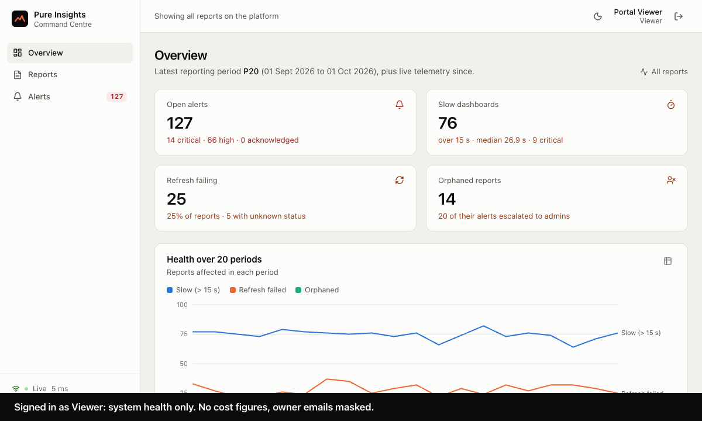
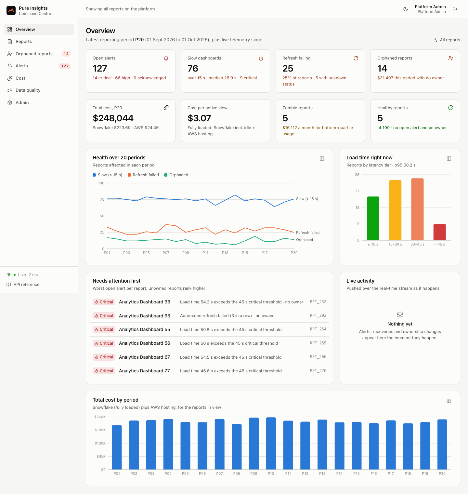
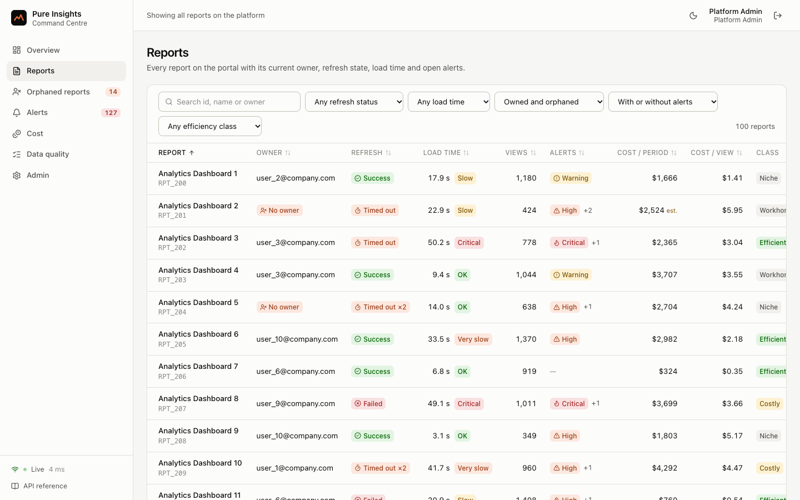
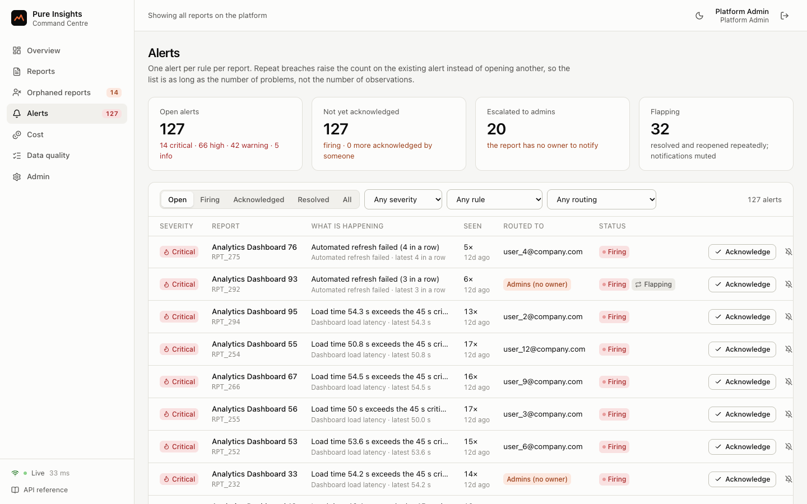
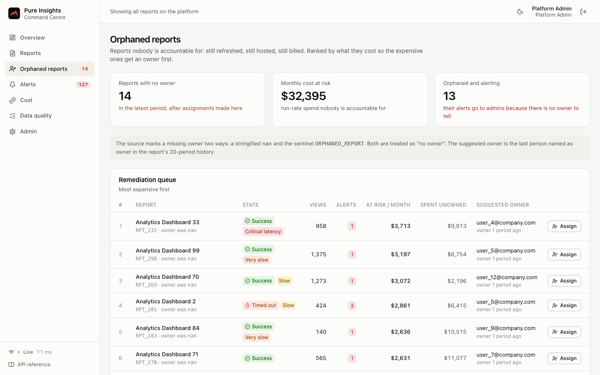
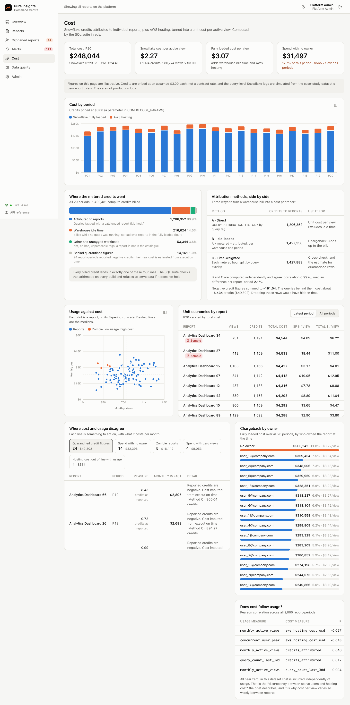
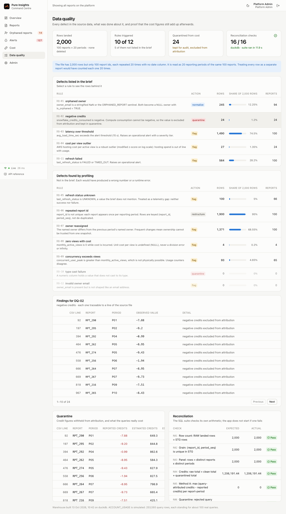
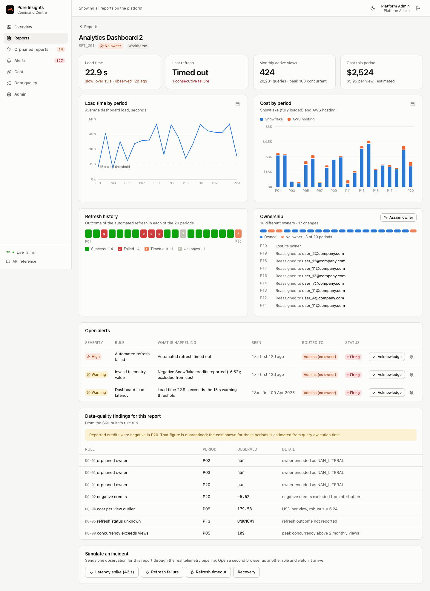
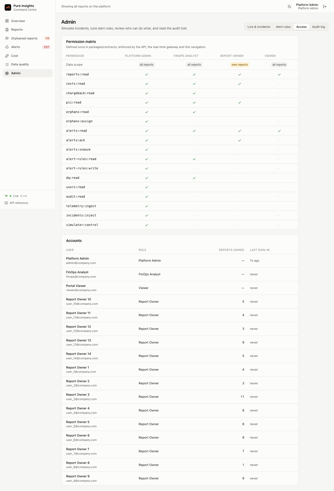

# Pure Insights Command Centre

Case Study 3 · Technical Data AI Validation (Monetization)

An operational admin dashboard for the Pure Insights analytics portal. It restores what the business lost when it moved off Tableau Server: who owns each report, which ones are failing or slow, and what each one costs in Snowflake credits.



*Recorded from the running app by `npm run demo:gif`: a viewer's screen receives an alert that an admin causes in a separate session.*

## Run it

Needs Node.js 22.13 or newer. No database, account or API key to set up.

```bash
npm install
npm run dev
```

Open http://localhost:5173 and pick a persona on the sign-in page. The first start builds the warehouse (simulates the query logs, runs the SQL suite, checks reconciliation), which takes around 15 seconds; later starts reuse it.

Or with Docker:

```bash
docker compose up --build
```

Then open http://localhost:4000.

| Persona | Sees |
| --- | --- |
| Platform Admin | Everything. Assigns owners, tunes alert rules, injects incidents, reads the audit log. |
| FinOps Analyst | Every cost, chargeback and data-quality view. Changes nothing. |
| Report Owner (`user_1` … `user_14@company.com`) | Only the reports they own, and those reports' alerts and cost. |
| Viewer | Health only. No cost figures; owner emails are masked. |

To see real-time alerting: open a second browser window as a different persona, then in the admin window open any report and click **Latency spike**. A five-minute guided tour is in [`docs/demo-script.md`](docs/demo-script.md).

## The three deliverables

| Deliverable | Where |
| --- | --- |
| 1. Runnable full-stack codebase | This repository: `apps/api` (Node.js, Express), `apps/web` (React), `packages/contracts` (shared schemas). |
| 2. REST API and WebSocket technical specification | [`docs/Technical-Specification.pdf`](docs/Technical-Specification.pdf) ([markdown](docs/Technical-Specification.md)). Machine-readable: [`openapi.json`](docs/api/openapi.json), [`asyncapi.json`](docs/api/asyncapi.json). Live at `/docs` when the app is running. |
| 3. Snowflake cloud cost allocation SQL suite | [`sql/`](sql/), with its own [README](sql/README.md). Run with `npm run sql:duckdb`. |

## What the data turned out to be

The brief lists four injected defects. Profiling found the dataset's structure and five more, and each changed the design.

| Finding | Consequence |
| --- | --- |
| **2,000 rows are 100 reports × 20 periods.** Each report id repeats 20 times in blocks of 100; there is no date column. | Rows are keyed `(report, period)`. Treating rows as reports would count each one 20 times; de-duplicating would throw away 95% of the data. It also gives every report a history, which the alerting and ownership features use. |
| **74.5% of observations exceed the 15-second threshold;** 82% break some alert rule. | A notification per breach would be noise. The alert engine groups repeat breaches into one alert per report, tiers severity, and mutes alerts that flap. The literal rule is still honoured: every breach produces an event. |
| **24 negative credit values** (documented), summing to −161 credits. | Quarantined, not deleted or zeroed. An independent attribution method then shows the queries behind them cost about **$49,300**, which filtering alone would have hidden. |
| **A fourth refresh status, `UNKNOWN`,** in 100 rows (not in the brief). | Treated as a monitoring gap: it neither opens nor closes a refresh-failure alert. |
| **Each report has 7 to 13 different owners** across its 20 rows; 14 are orphaned now, 94 were at some point. | One snapshot cannot be trusted for ownership. The orphan queue suggests the last known owner from history. |
| **4 rows with zero views and real cost;** 93 with peak concurrency above monthly views. | Unit cost per view is NULL for zero views, never a division error. Both are flagged. |
| **Usage and cost are uncorrelated** (every pair under 0.05). | This is the "discrepancy between active users and AWS cost" the brief mentions. It is quantified, and the reports with low usage and high cost are listed with a dollar figure. |
| **The file has totals, not `ACCOUNT_USAGE` logs.** | A seeded simulator disaggregates the totals into `QUERY_HISTORY`, `QUERY_ATTRIBUTION_HISTORY` and `WAREHOUSE_METERING_HISTORY`, reconciling exactly to the file. |

The full list, with row counts and source line numbers, is generated from the pipeline: [`docs/data-quality-report.md`](docs/data-quality-report.md).

## Where each rubric area is addressed

### Full-stack web architecture

- **One declaration per endpoint** mounts the route, validates the request, enforces the permission, validates the response and generates the OpenAPI operation: [`apps/api/src/http/registry.ts`](apps/api/src/http/registry.ts), [`routes.ts`](apps/api/src/http/routes.ts).
- **RBAC on three levels**, defined once in [`packages/contracts/src/rbac.ts`](packages/contracts/src/rbac.ts): endpoint permissions, row-level scope (owners see their own reports), and field-level redaction (no cost or unmasked email without the permission), applied on the server.
- **Session security**: in-memory access token, rotating httpOnly refresh cookie with reuse detection, scrypt password hashing, audit log on every write.
- **Orphaned reports** as a workflow, not a list: ranked by cost at risk, suggested owner, assignment with audit trail: [`apps/api/src/services/orphans.ts`](apps/api/src/services/orphans.ts).
- A composition root wires everything through constructors, which is what lets the tests run the real application on an in-memory database: [`apps/api/src/container.ts`](apps/api/src/container.ts).

### Real-time alerting and telemetry

- **Alert lifecycle engine**: [`apps/api/src/alerts/engine.ts`](apps/api/src/alerts/engine.ts), rules in [`rules.ts`](apps/api/src/alerts/rules.ts).
- **One telemetry pipeline** for the HTTP ingest endpoint, the simulator, the incident injector and the historical backfill; state and alerts commit together and events broadcast only afterwards: [`apps/api/src/telemetry/service.ts`](apps/api/src/telemetry/service.ts).
- **WebSocket and SSE gateway** with single-use tickets, per-recipient access control, resume by event id, heartbeats and backpressure: [`apps/api/src/realtime/gateway.ts`](apps/api/src/realtime/gateway.ts).
- **Client** with backoff and jitter, resume, de-duplication and SSE fallback: [`apps/web/src/lib/realtime.ts`](apps/web/src/lib/realtime.ts).

### Cloud cost SQL attribution

- Eight scripts in Snowflake SQL: [`sql/`](sql/). Three attribution methods compared side by side, unit cost per active view, chargeback, anomalies.
- **Sixteen reconciliation checks** that fail the build: every billed credit lands in exactly one line.
- **Verified on real Snowflake.** The same eight files ran unchanged on a Snowflake account (version 10.37, AWS): all 16 reconciliation checks pass there, and every result table (2,000 fact rows included) is identical to the DuckDB run. Evidence: [`docs/evidence/snowflake-run.md`](docs/evidence/snowflake-run.md). DuckDB runs the suite on every build.

### Code quality and system docs

- **118 tests** (`npm test`) and **8 browser scenarios** (`npm run test:e2e`). The access matrix is tested for every route against every role, derived from the route registry.
- **The specification cannot drift**: OpenAPI, AsyncAPI, the API reference and the data-quality report are generated from the code, and a test fails if the committed copies are stale.
- TypeScript strict mode end to end, one lint and format tool, CI workflow in [`.github/workflows/ci.yml`](.github/workflows/ci.yml).
- [Architecture and decisions](docs/architecture.md) · [Assumptions](docs/assumptions.md) · [Path to production](docs/production-path.md)

## Tableau Server parity

What the admin views of Tableau Server provided, and what replaces each.

| Tableau Server admin view | Command Centre |
| --- | --- |
| Traffic to Views | Views, queries and peak concurrency per report, 20-period history |
| Background Tasks for Extracts | Refresh status with failure streaks, alerts on failure and timeout |
| Stats for Load Times | Load time per report with severity tiers and threshold alerts |
| Content ownership | Current owner, ownership trail, orphan queue with remediation |
| Stale Content | Zombie reports: low usage against high cost, with monthly spend |
| (not in Tableau) | Snowflake credit attribution and unit cost per active view |
| (not in Tableau) | Real-time push, data-quality report, audit log |

## Commands

| Command | Does |
| --- | --- |
| `npm run dev` | API on 4000, web on 5173, with reload |
| `npm run build && npm start` | Production build; API serves the web app on 4000 |
| `npm test` | Unit, integration, SQL reconciliation and real-time tests |
| `npm run test:e2e` | Playwright against the production build |
| `npm run verify` | Lint, typecheck, tests, and the generated-docs drift check |
| `npm run sql:duckdb` | Run the SQL suite and print the reconciliation table |
| `npm run sql:snowflake` | Run the same suite on a Snowflake account and compare with DuckDB |
| `npm run docs:generate` | Regenerate OpenAPI, AsyncAPI, API reference, data-quality report |
| `npm run docs:pdf` | Rebuild the specification PDF |
| `npm run screenshots` / `npm run demo:gif` | Regenerate the README screenshots and the demo recording |
| `npm run reset` | Delete local state and the cached warehouse |

Configuration is by environment variable; every one has a default. See [`.env.example`](.env.example).

## Screens

| | |
| --- | --- |
|  |  |
|  |  |
|  |  |
|  |  |

## Scope and limits

- **`ACCOUNT_USAGE` is simulated**, because the dataset contains none. The SQL ran on real Snowflake, but against the simulated tables, not against `SNOWFLAKE.ACCOUNT_USAGE`. The simulator's assumptions are listed in [`docs/assumptions.md`](docs/assumptions.md); the one that matters most is how much the queries behind a negative credit figure really cost.
- **Demo mode is on by default**: seeded accounts, one-click sign-in, incident injection. Set `DEMO_MODE=false` and `JWT_SECRET` for anything else.
- **Single process.** The event bus and ticket store are in memory. The path to several nodes is in [`docs/production-path.md`](docs/production-path.md).
- **The dataset is the catalogue.** Reports are the 100 in the file; there is no create or delete.
