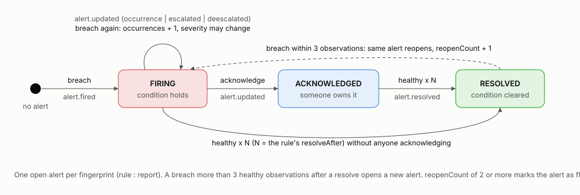

# Pure Insights Command Centre

## REST API and WebSocket Technical Specification

Version 1.0.0 · protocol version 1 · Case Study 3, Technical Data AI Validation

This document specifies the two interfaces of the Command Centre: the REST API under `/api/v1` and the real-time event stream delivered over WebSocket (`/ws`) and Server-Sent Events (`/api/v1/stream`).

It has two parts. Sections 1 to 9 are written by hand and explain the design and the rules a client must follow. Appendix A is generated from the code: the endpoint list, the access matrix and the event catalogue are produced from the same objects the server uses to route, authorise and validate, so they cannot describe something the server does not do. Machine-readable versions are in `docs/api/openapi.json` (OpenAPI 3.1) and `docs/api/asyncapi.json` (AsyncAPI 3.0), and the running server serves both, plus an interactive explorer at `/docs`.

## 1. System overview


The Command Centre restores the administrative visibility the business lost when it moved from Tableau Server to a custom portal. It answers four questions: which reports are unhealthy right now, who owns each report, what does each report cost, and can the source data be trusted.

| Component | Role |
| --- | --- |
| REST API | Reads (health, ownership, cost, data quality) and the few writes (acknowledge, assign owner, change a rule). |
| Telemetry pipeline | The one path every observation takes: validate, update report state, evaluate alert rules, commit, broadcast. |
| Alert engine | Turns observations into alerts with a lifecycle, so repeat breaches update one alert instead of opening many. |
| Event bus | Numbers every event and keeps a bounded buffer for replay. |
| Real-time gateway | Delivers events over WebSocket and SSE, applying the same access rules as the REST API to each recipient. |
| Warehouse | DuckDB locally, Snowflake in production. Built by the SQL suite in `sql/`; the API refuses to start if its reconciliation checks fail. |
| Operational store | SQLite locally, Postgres in production. Users, sessions, alerts, owner assignments, audit log. |

## 2. Conventions

| Topic | Rule |
| --- | --- |
| Base path | `/api/v1`. A breaking change gets a new prefix; additive changes do not. |
| Format | JSON, UTF-8. Timestamps are ISO-8601 in UTC. Field names are camelCase. |
| Identifiers | Reports are `RPT_<digits>`. Alerts are UUIDs. Periods are zero-based integers, shown as `P01` to `P20`. |
| Pagination | `page` (from 1) and `pageSize` (default 50, maximum 500). Responses carry `items`, `total`, `page`, `pageSize`. |
| Validation | Every path, query and body is validated against a schema before the handler runs. Unknown enum values and out-of-range numbers are rejected, not coerced. |
| Request id | Every response carries `X-Request-Id`. A caller may supply one; it is echoed, logged, and written to the audit log. |
| Rate limits | 600 requests a minute per client; 20 a minute on sign-in endpoints. Exceeding it returns 429 with `RateLimit` headers. |
| Responses are checked too | Outside production, each response is validated against its declared schema, so a handler that drifts from the contract fails its tests. |

### 2.1 Errors

Every error, from every endpoint, is an RFC 9457 problem document with content type `application/problem+json`.

```json
{
  "type": "https://pure-insights.example/problems/validation_failed",
  "title": "Request validation failed",
  "status": 400,
  "code": "validation_failed",
  "detail": "Invalid query.",
  "requestId": "8c0d6ec9-b879-4d91-bc17-7cbd381affa5",
  "errors": [{ "path": "query.pageSize", "message": "Too small: expected number to be >=1" }]
}
```

| Status | `code` | Meaning |
| --- | --- | --- |
| 400 | `validation_failed`, `bad_request` | The request does not match the schema; `errors` lists each field. |
| 401 | `unauthorized` | No credentials, or they are invalid or expired. |
| 403 | `forbidden` | Authenticated, but the role lacks the permission named in `detail`. |
| 404 | `not_found` | No such object, **or it is outside the caller's row-level scope**. The two are deliberately indistinguishable. |
| 409 | `conflict` | The request is valid but contradicts current state (alert already acknowledged, thresholds out of order). |
| 429 | `rate_limited` | Rate limit exceeded. |
| 500 | `internal_error`, `response_contract_violation` | Unexpected failure. The body never contains internals; use `requestId` to find the log line. |

## 3. Authentication

Three credentials exist, each for one purpose.

| Credential | Held by | Lifetime | Sent as |
| --- | --- | --- | --- |
| Access token (JWT, HS256) | Browser memory only | 15 minutes | `Authorization: Bearer <token>` |
| Refresh token (opaque, random) | httpOnly, SameSite=Strict cookie scoped to `/api/v1/auth` | 7 days, rotated on every use | Cookie, only to `/api/v1/auth/*` |
| Real-time ticket (opaque, random) | Used immediately | 30 seconds, single use | `?ticket=` on the stream URL |

Sign-in flow:

1. `POST /api/v1/auth/login` with email and password returns an access token and the user (role, scope, permissions), and sets the refresh cookie.
2. The client sends the access token on every request. It is never written to `localStorage`, so injected script cannot lift a long-lived credential.
3. When a request returns 401, the client calls `POST /api/v1/auth/refresh` once, receives a new access token and a new refresh cookie, and replays the request.
4. `POST /api/v1/auth/logout` revokes the session.

Design decisions that matter:

- **Refresh tokens are stored only as a SHA-256 hash and rotate on every use.** Presenting a token that has already been rotated means two parties hold the same token; the server revokes the whole session family. A stolen cookie becomes a detectable event.
- **Role is read from the database on every request, not from the token.** Demoting or deleting a user takes effect on their next request rather than when the token expires.
- **Sign-in failures are indistinguishable.** A wrong password and an unknown account return the same status and message and take the same time: an unknown email is still checked against a real hash, so response time does not reveal which addresses have accounts. Failed attempts are written to the audit log, without the attempted password.
- **A first visit makes no failing request.** Alongside the refresh cookie the server sets `picc_signed_in=1`, a script-readable flag with no secret in it. The client only attempts a session restore when that flag is present.
- **State-changing requests authenticate with the bearer header, not the cookie.** The cookie is only ever sent to the auth path, so cross-site request forgery has nothing to ride on.
- **Passwords** are hashed with scrypt (N=16384, r=8, p=1) and a per-user salt.

The WebSocket endpoint additionally checks the `Origin` header in production: the page the API serves is same-origin and always accepted; any other origin must be on the `CORS_ORIGIN` allow-list.

A second identity exists for machines: the portal's telemetry emitter authenticates to `POST /api/v1/telemetry` with an `X-API-Key` header. That key grants `telemetry:ingest` and nothing else, and is not honoured on any other route.

**Demo mode.** With `DEMO_MODE=true` the server seeds one account per persona and enables `POST /api/v1/auth/demo-login` (one-click sign-in) and the incident injector. Both return 403 when demo mode is off. In production, sign-in would be delegated to the corporate identity provider over OIDC; the `Principal` the rest of the system consumes would be built from the ID token's claims instead of a local user row.

## 4. Authorisation

Access is decided on three levels. All three are defined once, in `packages/contracts/src/rbac.ts`, and applied by the REST handlers and the real-time gateway through the same functions.

| Level | Question | Mechanism |
| --- | --- | --- |
| Endpoint | May this role call this operation? | Each route declares one permission. Roles map to permissions; handlers never test role names. |
| Row | Which reports may this user see? | Each role has a data scope. `all` sees every report; `own` sees only reports whose current owner is the user. |
| Field | Which attributes may this user see? | Without `costs:read` the `cost` object is `null`. Without `pii:read` owner emails are masked to `u***@company.com`. |

Four roles ship: Platform Admin, FinOps Analyst, Report Owner and Viewer. The permission matrix and the endpoint-by-role access matrix are in Appendix A.

Two properties are worth stating because they are easy to get wrong:

- **Redaction is done on the server.** A viewer's response does not contain cost figures hidden by the interface; it does not contain them at all. Sorting by a cost column without `costs:read` silently falls back to sorting by report id, so ordering cannot leak the values either.
- **Masking does not leak through shape or filters.** Only the first character and the domain survive, with a fixed number of stars: keeping the last character or the length would let a viewer tell `user_7` from `user_12`, which for fourteen owners is no masking at all. For the same reason the `owner` filter on `GET /reports` requires `pii:read`; without it a caller could confirm who owns what one guess at a time.
- **The real-time stream is not a side door.** Every event is rendered separately for each connection through the same presenter the REST API uses. A Report Owner does not receive events about other people's reports on any topic, and a viewer receives masked emails.

"Current owner" is the owner in the latest reporting period, unless an administrator has assigned one in the Command Centre, in which case the assignment wins.

## 5. REST resources

The full list is in Appendix A. This section explains the resources whose behaviour is not obvious from a path and a schema.

### 5.1 Reports

`GET /reports` returns one row per report with its current owner, refresh state, load time, open alert count and, with `costs:read`, its cost block. It filters on `q`, `owner`, `orphaned`, `refreshStatus`, `latencySeverity`, `quadrant` and `hasAlerts`, and sorts on eight fields.

`GET /reports/{reportId}` adds the 20-period history, the ownership trail, open alerts and the data-quality findings for that report.

```json
{
  "reportId": "RPT_233",
  "reportName": "Analytics Dashboard 34",
  "ownerEmail": "user_1@company.com",
  "ownerSource": "telemetry",
  "isOrphaned": false,
  "refreshStatus": "SUCCESS",
  "refreshFailureStreak": 0,
  "loadTimeSec": 29.5,
  "latencySeverity": "WARNING",
  "monthlyActiveViews": 731,
  "efficiencyQuadrant": "ZOMBIE",
  "activeAlerts": 1,
  "highestAlertSeverity": "warning",
  "cost": {
    "creditsAttributed": 1190.54,
    "creditsFullyLoaded": 1427.58,
    "totalCostUsd": 4544.28,
    "snowflakeCostPerViewUsd": 4.89,
    "totalCostPerViewUsd": 6.22,
    "isCostImputed": false,
    "isCostQuarantined": false
  }
}
```

`creditsAttributed` is what Snowflake attributes to the report's own queries. `creditsFullyLoaded` adds the report's share of warehouse idle time. `isCostImputed` is true when the reported credit figure was invalid and the cost was estimated from execution time instead; see the SQL suite's README.

### 5.2 Orphaned reports

`GET /orphans` returns reports with no owner, ranked by `costAtRiskUsd` (monthly run-rate), each with a `suggestedOwner` taken from the report's own ownership history.

`POST /reports/{reportId}/owner` assigns an owner. In one request it writes the assignment, records an audit entry, broadcasts `report.owner_changed`, and re-routes the report's open alerts from administrators to the new owner (each gets an `alert.updated` with `change: "rerouted"`). The assignee must be an existing Report Owner account; anything else is a 400 with a field error.

### 5.3 Alerts

`GET /alerts` lists alerts, worst first. `status` accepts `active` (the default: firing or acknowledged), `firing`, `acknowledged`, `resolved` or `all`. `GET /alerts/{alertId}` adds the timeline of every transition and who caused it.

`POST /alerts/{alertId}/ack` marks an alert as taken. An acknowledged alert still resolves by itself when the condition clears, and still escalates if it gets worse. `POST /alerts/{alertId}/snooze` silences notifications for a number of minutes without changing the alert's state.

`PUT /alert-rules/{ruleId}` changes thresholds. Tiers must increase (`warning < high < critical`) or the request is refused with 409, and a request that changes nothing is a 400. New thresholds apply from the next observation. Disabling a rule resolves the alerts it had open, with a timeline entry naming who disabled it: a rule that is no longer evaluated could never clear them itself.

### 5.4 Telemetry ingest

`POST /api/v1/telemetry` is the integration point for the portal. It accepts up to 1,000 events per request.

```json
{
  "events": [
    { "reportId": "RPT_203", "loadTimeSec": 42.5, "refreshStatus": "SUCCESS" },
    { "reportId": "RPT_999999", "loadTimeSec": 3 }
  ]
}
```

Each event needs a `reportId` and at least one of `loadTimeSec`, `refreshStatus`, `creditsConsumed`.

`observedAt` is optional and defaults to the time of receipt. When supplied it must be ISO-8601 with a time zone, and the event is rejected if the timestamp is more than five minutes in the future or older than the newest observation already held for that report. A late event would otherwise overwrite the report's current state with a stale one.

Events are validated one by one, so a malformed event does not reject the batch. The response is `202 Accepted`:

```json
{
  "accepted": 1,
  "rejected": [{ "index": 1, "reason": "Unknown report RPT_999999" }],
  "alertsFired": 1,
  "alertsResolved": 0
}
```

Negative `creditsConsumed` is accepted on purpose. Refusing it would hide a broken emitter; accepting it raises an `invalid_telemetry` alert and keeps the value out of every cost figure.

Within a batch, state changes and alert changes are written in one transaction and events are broadcast only after it commits. A client is never told about an alert that a rollback then erases.

### 5.5 Cost and data quality

`GET /costs/summary` returns cost by period for the reports in scope. Callers with scope `all` also receive `platform`: how the metered bill splits into report credits, idle time, unattributed workloads and quarantined figures, and how the three attribution methods compare. `GET /costs/reports` gives unit economics per report for `latest`, `lifetime` or a numbered period. `GET /costs/chargeback` gives cost by owner with the unowned pool as its own line. `GET /costs/anomalies` lists zombie reports, orphaned spend, zero-view spend and quarantined figures, each with a monthly dollar impact.

`GET /dq/summary` returns every data-quality rule with its row count and the reconciliation checks. `GET /dq/findings` returns individual violations, each with the line number of the source file it came from. `GET /dq/quarantine` returns the rows withheld from cost attribution alongside the estimate that replaces them.

## 6. Alerting model



The brief asks for a notification "whenever dashboard load latency exceeds 15 seconds or automated refreshes fail". That rule is implemented literally: every breaching observation produces an event on the stream. Profiling the dataset showed why that cannot be the whole design: 1,490 of 2,000 observations (74.5%) exceed 15 seconds, and 82% break at least one rule. An alert per observation would be noise that people learn to ignore.

So the engine adds a lifecycle on top of the literal rule:

| Mechanism | What it does |
| --- | --- |
| Fingerprint | One open alert per rule per report (`latency:RPT_203`). A repeat breach increments `occurrences` and sends `alert.updated`, not a second `alert.fired`. |
| Severity tiers | Latency: warning above 15 s, high above 30 s, critical above 45 s. Refresh: high, then critical from the third consecutive failure. |
| Hysteresis | An alert resolves only after `resolveAfter` consecutive healthy observations (2 for latency, 1 for refresh), so one good reading between bad ones does not clear it. While it waits, the alert carries `healthyStreak` and the interface labels it "Recovering 1/2". This is why a report's current reading can be healthy while its alert is still open: the report row shows the latest observation, the alert shows the incident. |
| Reopen | A breach within 3 healthy observations of a resolve reopens the same alert and increments `reopenCount`. |
| Flap detection | `reopenCount` of 2 or more sets `isFlapping`. Clients stop notifying for it. |
| Routing | To the report's owner. If the report has no owner, to administrators with `escalated: true`: an alert on an orphaned report would otherwise notify nobody. |
| Acknowledge and snooze | A person takes the alert, or silences it for a while. Both are audited and broadcast. |

Rule evaluation is a pure function of the rule and the observation. Three boundary decisions are fixed in tests:

- "Exceeds 15 seconds" is strictly greater than. Exactly 15.0 s is not a breach.
- `TIMED_OUT` counts as a refresh failure, the same as `FAILED`.
- `UNKNOWN` is neither a failure nor a success. It does not open a refresh-failure alert, does not resolve one, and does not extend a failure streak. It raises its own low-severity `refresh_unknown` alert, because not knowing whether data is fresh is a monitoring gap in its own right.

On first start the engine replays the dataset's 20 periods through the same pipeline, oldest first. The alert history a new installation shows is therefore computed, not seeded: streaks, reopen counts and timelines come from the real data.

## 7. Real-time protocol

### 7.1 Choosing a transport

Both transports carry the same events in the same envelope. WebSocket is the default because it gives the client a channel back to the server for heartbeats and subscription changes. Server-Sent Events exists for networks and proxies that block WebSocket upgrades; the reference client falls back to it after three failed WebSocket attempts.

| | WebSocket `/ws` | SSE `/api/v1/stream` |
| --- | --- | --- |
| Direction | Both ways | Server to client |
| Change topics while connected | `subscribe` / `unsubscribe` messages | Reconnect with a new `topics` value |
| Resume | `?lastEventId=` | `Last-Event-ID` header, or `?lastEventId=` |
| Liveness | Protocol ping from the server; optional application `ping` | Comment line every 25 seconds |
| Refused connection | Close code 4401 | HTTP 401 problem document |

### 7.2 Connecting

Browsers cannot attach an `Authorization` header to a WebSocket or EventSource request, and a JWT in a URL ends up in access logs. So the client exchanges its bearer token for a ticket first.

```
POST /api/v1/realtime/ticket          Authorization: Bearer <access token>
 -> { "ticket": "kT3...", "expiresIn": 30, "wsPath": "/ws", "ssePath": "/api/v1/stream" }

GET  /ws?ticket=kT3...&topics=alerts,reports,system&lastEventId=118     (Upgrade: websocket)
```

A ticket is 24 random bytes, works once, and expires in 30 seconds. A reused, expired or unknown ticket closes the WebSocket with code 4401. The upgrade is accepted before the ticket is checked on purpose: a browser cannot read the HTTP status of a refused upgrade, but it can read a close code.

Query parameters:

| Parameter | Required | Meaning |
| --- | --- | --- |
| `ticket` | yes | From `POST /api/v1/realtime/ticket`. |
| `topics` | no | Comma-separated. Default `alerts,reports,system`. |
| `lastEventId` | no | Resume point: replay every buffered event with a greater id. |
| `streamId` | with `lastEventId` | The `streamId` from the `connection.ready` that issued that event id. |

### 7.3 Envelope

Every message from the server has the same shape.

```json
{
  "v": 1,
  "id": 9,
  "type": "alert.fired",
  "ts": "2026-10-13T09:00:00.000Z",
  "data": { }
}
```

| Field | Meaning |
| --- | --- |
| `v` | Protocol version. A breaking change increments it. |
| `id` | Monotonically increasing event id. `0` for connection-scoped messages, which are never replayed. |
| `type` | Event type; selects the shape of `data`. |
| `ts` | Server time the event was published. |
| `data` | Payload. |

The first message on every connection is `connection.ready`:

```json
{
  "v": 1, "id": 0, "type": "connection.ready", "ts": "2026-10-13T09:00:00.000Z",
  "data": {
    "connectionId": "6f1c...",
    "protocolVersion": 1,
    "user": { "email": "admin@company.com", "role": "admin", "scope": "all" },
    "topics": ["alerts", "reports", "system"],
    "heartbeatIntervalMs": 25000,
    "streamId": "9f2c41d07a3e",
    "latestEventId": 121,
    "resumedFrom": 118,
    "replayed": 3
  }
}
```

### 7.4 Topics

| Topic | Carries | Subscribed by default |
| --- | --- | --- |
| `alerts` | `alert.fired`, `alert.updated`, `alert.resolved` | yes |
| `reports` | `report.owner_changed` | yes |
| `system` | `system.notice` | yes |
| `telemetry` | `telemetry.observed`: every observation, high volume | no |

Subscribing to a topic does not widen access. Row-level and field-level rules are applied to every event before it is sent.

### 7.5 Events

The complete catalogue with schemas is in Appendix A and `asyncapi.json`. An alert opening looks like this:

```json
{
  "v": 1, "id": 9, "type": "alert.fired", "ts": "2026-10-13T09:00:00.000Z",
  "data": {
    "alert": {
      "id": "2d4b863d-b4b2-45ed-a2f5-13674e87c0ea",
      "fingerprint": "latency:RPT_203",
      "ruleId": "latency",
      "ruleName": "Dashboard load latency",
      "reportId": "RPT_203",
      "reportName": "Analytics Dashboard 4",
      "severity": "high",
      "status": "firing",
      "message": "Load time 42.5 s exceeds the 30 s high threshold",
      "value": 42.5,
      "threshold": 30,
      "unit": "seconds",
      "occurrences": 1,
      "reopenCount": 0,
      "isFlapping": false,
      "healthyStreak": 0,
      "resolveAfter": 2,
      "firstSeenAt": "2026-10-13T09:00:00.000Z",
      "lastSeenAt": "2026-10-13T09:00:00.000Z",
      "resolvedAt": null,
      "acknowledgedBy": null,
      "snoozedUntil": null,
      "routing": { "kind": "owner", "ownerEmail": "user_3@company.com", "escalated": false },
      "source": "api"
    }
  }
}
```

`alert.updated` carries the same alert plus a `change` field that says why it was sent:

| `change` | Cause | Suggested client behaviour |
| --- | --- | --- |
| `occurrence` | Another breaching observation, same severity | Update the row quietly. |
| `recovering` | A healthy observation arrived, but fewer than `resolveAfter` in a row | Show progress (`healthyStreak` of `resolveAfter`); do not notify. |
| `escalated` / `deescalated` | Severity moved | Notify on escalation to critical. |
| `acknowledged` / `snoozed` | A person acted | Update the row; show who. |
| `reopened` | Breach returned soon after resolving | Notify unless `isFlapping`. |
| `rerouted` | The report was given an owner | Update routing. |

### 7.6 Client messages (WebSocket only)

```json
{ "type": "ping", "ts": 1791868327978 }
{ "type": "subscribe", "topics": ["telemetry"] }
{ "type": "unsubscribe", "topics": ["telemetry"] }
```

`ping` is answered with `pong` echoing `ts`, which gives the client a round-trip time. `subscribe` and `unsubscribe` are answered with `subscribed` carrying the resulting topic set. A message that is not valid JSON, or not one of these three, is answered with an `error` event; the connection stays open. Messages larger than 16 KB are refused.

### 7.7 Delivery guarantees and resume

- **Ordering.** Events on a connection arrive in increasing `id` order.
- **At-least-once.** After a resume, a client may see an event it already processed. Clients must ignore any `id` not greater than the last one they handled.
- **Resume.** The server keeps the most recent 2,000 events. A client that reconnects with `lastEventId` receives everything after it, filtered by its topics and its access, before live events continue. `connection.ready.replayed` says how many are coming.
- **Gap.** If the requested id has already left the buffer, the server sends `replay.gap` with `oldestAvailable`. The client must then refetch current state over REST. Live events continue normally.
- **Restart.** Event ids start again from 1 when the server restarts, so an id is only meaningful within the stream that issued it. `connection.ready` carries a `streamId`; the client returns it with `lastEventId`. If it does not match the current stream, nothing is replayed, `resumedFrom` is null, and the server sends `replay.gap`. The client must then forget its old id. Without this, a client holding id 5000 from before a restart would discard every new event as already seen.
- **Not guaranteed.** Events published while no buffer entry survives (a server restart) are lost to the stream; REST remains the source of truth, and a client should refetch after any reconnect that reports a gap.

### 7.8 Liveness, limits and close codes

The server sends a protocol-level ping every 25 seconds and closes a connection that has not answered by the next one. A client whose unsent backlog exceeds 1 MB is disconnected rather than buffered without bound. Connections are closed after 60 minutes so the client re-authenticates with a fresh ticket; because of resume, this is invisible to the user.

| Code | Meaning | Client action |
| --- | --- | --- |
| 4401 | Ticket missing, expired, reused, or the session is too old | Fetch a new ticket and reconnect. |
| 4408 | No heartbeat answered | Reconnect with backoff. |
| 4429 | Client is not reading fast enough | Reconnect; consider unsubscribing from `telemetry`. |
| 4430 | More than 60 client messages in 10 seconds | Fix the client; a correct one sends a ping every 25 seconds. |
| 1001 | Server is shutting down | Reconnect with backoff. |

### 7.9 Reference client algorithm

Implemented in `apps/web/src/lib/realtime.ts`.

1. Request a ticket. Open the WebSocket with `topics` and, if known, `lastEventId`.
2. On `connection.ready`, reset the retry counter, remember `streamId`, and start sending `ping` every `heartbeatIntervalMs`. If `streamId` changed or `resumedFrom` is null, set the last handled id to 0.
3. For each event with `id > 0`: if `id` is not greater than the last one handled, drop it; otherwise handle it and remember the id.
4. On close, wait `min(30 s, 2^attempt s)` with jitter between half and all of that value, then go to step 1. Jitter matters: without it every browser reconnects in the same instant after a server restart.
5. After three failures to establish a WebSocket, use SSE instead. Because the ticket in an EventSource URL is already spent, do not let EventSource reconnect on its own: close it and go to step 1.
6. On `replay.gap`, refetch every cached list.

## 8. Instrumenting the portal

Two things make this system work against the real portal, and both are small.

**Emit telemetry.** After each dashboard load and each scheduled refresh, post one event to `POST /api/v1/telemetry` with the report id and the load time or refresh outcome. Batch them; the endpoint takes 1,000 at a time.

**Tag every Snowflake query.** The portal runs all queries as one service user, so `USER_NAME` in `ACCOUNT_USAGE` cannot identify a report. The only reliable handle is the session's `QUERY_TAG`. Set it before each statement:

```sql
ALTER SESSION SET QUERY_TAG = '{"app":"pure-insights","report_id":"RPT_203","component":"dashboard"}';
```

| Key | Values | Used for |
| --- | --- | --- |
| `app` | `pure-insights` | Separating portal queries from everything else on the warehouse. |
| `report_id` | Catalogue id | Attribution. |
| `component` | `dashboard` or `refresh` | Splitting interactive cost from refresh cost. |

Queries with no tag, a tag that is not JSON, or a `report_id` that is not in the catalogue are not dropped. The SQL suite classifies them (`UNTAGGED`, `UNPARSEABLE_TAG`, `UNKNOWN_REPORT`, `OTHER_WORKLOAD`) and reports them as their own lines, so the size of the instrumentation gap is always visible.

## 9. Operational characteristics

| Topic | Behaviour |
| --- | --- |
| Health | `GET /healthz` (liveness) and `GET /readyz` (503 unless the warehouse reconciled). Both unauthenticated. |
| Logging | Structured JSON, one line per request with request id, user, status and duration. Authorization headers, cookies, API keys, passwords and tokens are redacted at the logger. |
| Audit | Every state-changing action writes who, what, target, detail and request id to an append-only table, readable at `GET /audit-log`. |
| Security headers | Content-Security-Policy with no inline scripts, HSTS, no-sniff and frame protections on every response. |
| Proxies | `X-Forwarded-For` is ignored unless `TRUST_PROXY` says how many proxies are in front; otherwise a caller could choose their own rate-limit key. |
| Schema changes | The operational database carries a schema version and upgrades itself in place on start. |
| Malformed input | A request line or frame the server cannot parse is dropped at the socket; it cannot raise an exception outside a handler. |
| Shutdown | On SIGTERM the server stops the simulator, closes streams with code 1001, drains HTTP and closes the database. |
| Scale-out | The event bus is the seam. Behind a load balancer, `publish` writes to a shared log (Redis Streams, or SNS with a queue per node) and each node delivers to its own connections; event ids become stream offsets. Tickets move to the shared store. Nothing else changes. |

## 10. Trying it

```bash
# Sign in (demo mode) and keep the token
TOKEN=$(curl -s -X POST localhost:4000/api/v1/auth/demo-login \
  -H 'content-type: application/json' -d '{"email":"admin@company.com"}' | jq -r .accessToken)

# System health
curl -s localhost:4000/api/v1/overview -H "authorization: Bearer $TOKEN" | jq '.reports, .alerts'

# Open a stream in one terminal (requires wscat)
TICKET=$(curl -s -X POST localhost:4000/api/v1/realtime/ticket -H "authorization: Bearer $TOKEN" | jq -r .ticket)
wscat -c "ws://localhost:4000/ws?ticket=$TICKET"

# ...and cause an alert from another
curl -s -X POST localhost:4000/api/v1/telemetry -H "authorization: Bearer $TOKEN" \
  -H 'content-type: application/json' -d '{"events":[{"reportId":"RPT_203","loadTimeSec":42.5}]}'
```
