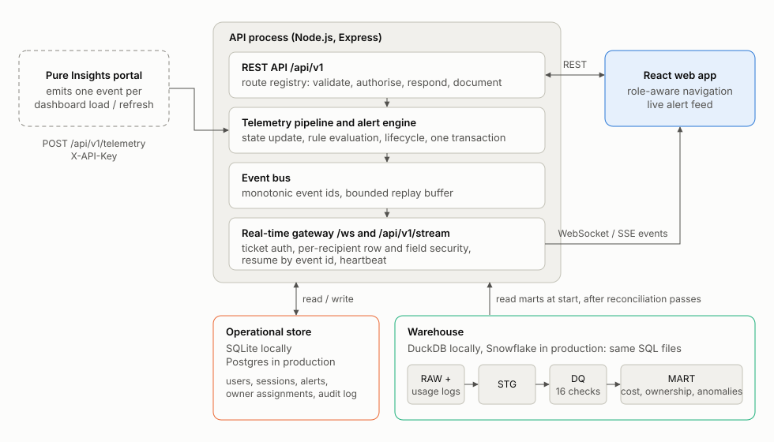

# Architecture



## Repository map

```
apps/api/src
  http/          route registry, error model, all REST routes
  auth/          passwords, tokens, the Principal
  alerts/        rules (pure), engine (lifecycle), repository, service
  telemetry/     the ingest pipeline, the built-in simulator
  realtime/      event bus, ticket store, WebSocket + SSE gateway
  services/      reports, cost, data quality, orphans, ownership, presenters
  warehouse/     ACCOUNT_USAGE simulator, SQL runner, DuckDB adapter, snapshot
  opsdb/         operational store: schema, repositories, demo seed
  docs/          OpenAPI, AsyncAPI and markdown generators
  container.ts   composition root
apps/web/src
  lib/           API client, real-time client, formatters
  auth/, realtime/   session and live-event providers
  components/    UI primitives, status badges, charts, layout
  pages/         one file per screen
packages/contracts   zod schemas, role matrix, real-time protocol: shared by both apps
sql/             the cost allocation suite
e2e/             Playwright tests
tools/           Snowflake runner, PDF builder, packaging
```

## How data moves

**At start-up.** The simulator writes `ACCOUNT_USAGE` files. The SQL suite runs on DuckDB and its 16 reconciliation checks must pass. The marts are read into memory once (100 reports, 2,000 report-periods: small). On the first start only, the 20 periods are replayed through the telemetry pipeline so that alert history is computed from the data.

**A telemetry event arrives.** Whoever sends it (the portal over HTTP, the built-in simulator, the incident injector) it takes one path: validate, update the report's state, evaluate every rule, apply the alert lifecycle, commit. Only after the commit are events published to the bus, and the gateway renders each one separately for every connected user.

**A user asks for something.** The route registry authenticates, checks the route's permission, validates the input, calls a service, and (outside production) validates the output against its schema. Services ask the ownership service which reports the caller may see and pass every record through a presenter that removes what the caller may not.

## Decisions

Each records what was chosen, what was not, and why.

### 1. One declaration per endpoint

A route is one object: path, schemas, permission, handler. The same object mounts the Express handler, validates the request, enforces the permission, validates the response and emits the OpenAPI operation. *Instead of* hand-written route files plus a separately maintained specification. *Because* the specification is a deliverable, and a specification that can drift from the code will. The access-matrix test iterates the same registry, so a new endpoint is covered by the RBAC tests the moment it is registered.

### 2. Permissions, scope and redaction in one shared package

Roles map to permissions and a data scope in `packages/contracts`. The API, the real-time gateway and the React navigation all read that table. *Instead of* role checks in handlers and a parallel set in the UI. *Because* the gateway is the usual place access control gets forgotten: REST is locked down and the WebSocket leaks. Here both go through `presenters.ts`.

### 3. An alert lifecycle, not a threshold check

Described in the technical specification, section 6. *Instead of* emitting a notification per breaching observation. *Because* 82% of observations in the dataset breach a rule. The literal rule from the brief is kept (every breach produces an event); the lifecycle is what makes the result usable.

### 4. WebSocket with a documented protocol, SSE as fallback

The `ws` library and an explicit envelope, tickets, topics and resume. *Instead of* Socket.IO. *Because* the deliverable is a protocol specification, and Socket.IO's own framing would sit between the specification and the wire. The cost is writing reconnection and resume by hand, which is about 150 lines on each side and is tested.

### 5. Tickets for stream authentication

*Instead of* a JWT in the WebSocket URL or a cookie. *Because* URLs are logged, and a cookie-authenticated WebSocket is open to cross-site hijacking. A 30-second single-use ticket is worthless in a log.

### 6. Two stores

DuckDB for the analytical warehouse, SQLite for operational state. *Instead of* one database. *Because* that is the production topology (Snowflake and Postgres), so the seam is already in the right place. Both are embedded, so there is still nothing to install.

### 7. The application runs the SQL deliverable

The cost figures on screen come from the scripts in `sql/`, executed at start-up. *Instead of* re-implementing the calculations in TypeScript. *Because* two implementations would disagree eventually, and this way the SQL suite is exercised on every start and every test run.

### 8. Snowflake dialect, executed on DuckDB

*Instead of* requiring a Snowflake account to run anything, or writing generic SQL that is not really Snowflake. *Because* an evaluator must be able to run the project with one command. The price is staying inside a common subset, listed in `sql/README.md`.

### 9. Quarantine, then estimate

Negative credit figures are withheld from attribution and kept. Their cost is estimated by an independent method. *Instead of* deleting the rows, taking the absolute value or clamping to zero. *Because* each of those silently changes a total that finance will read, and the queries behind the bad figure were still billed.

### 10. Node's built-in test runner and SQLite driver

*Instead of* Vitest and `better-sqlite3`. *Because* the current Vitest release crashes `npm install` on npm 10, and a native add-on is one more thing that can fail on an evaluator's machine. Zero-install tooling was worth more than familiarity.

## What is tested

| Layer | Tests | What they establish |
| --- | --- | --- |
| SQL suite | 16 reconciliation checks, plus defect counts | The cost model adds up; every defect is counted. |
| Simulator | Determinism, exact disaggregation | Simulated logs sum back to the dataset for all 2,000 report-periods. |
| Alert engine | 23 lifecycle cases + 6,000 random observations against a reference model | Dedup, tiers, hysteresis and the recovering state, reopen, flapping, the three boundary decisions. |
| Access | Every route × every role, plus anonymous | 401, 403 or allowed, exactly as the role table says. |
| API | Auth, errors, reports, orphans, telemetry, cost, data quality | Behaviour, and that responses match their schemas. |
| Real-time | Bus, tickets, WebSocket, SSE | Delivery, row and field security on the stream, resume, heartbeats, the production origin check. |
| Documentation | Drift checks | Committed OpenAPI, AsyncAPI and reports equal what the code generates. |
| Other input files | Dirty, flat, single-row and incomplete variants | The pipeline is not fitted to the one file it was developed against. |
| Hardening | 20 regression tests | Each defect found by trying to break the system stays fixed. See `docs/testing.md`. |
| Browser | 8 scenarios + a 14-test sweep | Per-role experience; a live alert crossing two sessions; orphan remediation; no console errors, failed requests, broken values, sideways scroll or WCAG AA violations on any page for any role, light or dark. |
