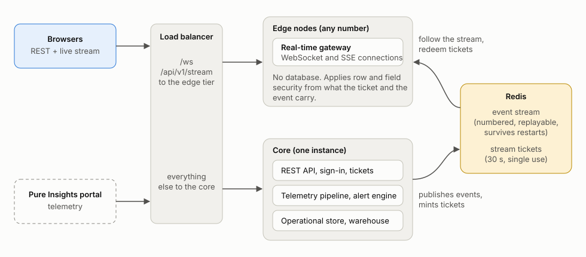

# Running it for real

The case-study brief describes a tool the business will depend on, not a one-off analysis of a file. This page covers what was added for that: what each piece does, how it is switched on, and what proves it works. Every item here was built and tested on this machine; what still needs infrastructure that could not be tested here is listed at the end and in [production-path.md](production-path.md).

None of it changes how the project starts. `npm install && npm run dev` and `docker compose up --build` work exactly as before, with nothing extra to install. Each capability is switched on by configuration.

| Capability | Why it matters | Switched on by | Proof |
| --- | --- | --- | --- |
| [Alert notifications](#1-alert-notifications) | An alert nobody sees is not an alert | `NOTIFY_WEBHOOK_URL` | 11 tests, one over real HTTP |
| ["No data" detection](#2-noticing-when-data-stops) | A dashboard that has stopped receiving data looks healthy | on by default | 4 tests |
| [Stored readings and live trends](#3-stored-readings-and-live-trends) | "Is it getting worse right now?" | on by default | 6 tests, 1 browser test |
| [Safe resends](#4-safe-resends) | A retry after a timeout must not double-count | `eventId` on each event | 4 tests |
| [Metrics](#5-metrics) | Operators need to see inside | `GET /metrics` | 3 tests, 1 browser test |
| [Load test](#6-load-test) | Know the limit before production finds it | `npm run load-test` | [evidence/load-test.md](evidence/load-test.md) |
| [Warehouse refresh without a restart](#7-warehouse-refresh-without-a-restart) | New cost data every hour, no downtime | `WAREHOUSE_REFRESH_MIN`, or the Admin button | 5 tests, 1 browser test |
| [Reading from Snowflake directly](#8-reading-from-snowflake-directly) | The real warehouse, not a local copy | `WAREHOUSE=snowflake` | [evidence/snowflake-live-read.md](evidence/snowflake-live-read.md) |
| [Scale-out with Redis](#9-scale-out-with-redis) | More browsers than one server can hold; deploys that drop nobody | `REDIS_URL`, `ROLE=edge` | 8 tests, [evidence/redis-scale-out.md](evidence/redis-scale-out.md) |

## 1. Alert notifications

The dashboard shows alerts to people who are looking at it. Notifications reach the people who are not.

**What is announced, per alert and per time it opens:**

| Event | When | To |
| --- | --- | --- |
| Opened or reopened | Once, at or above the minimum severity (default `high`). Not if the alert is snoozed or flapping. | The report's owner, or the platform admins if it has none |
| Escalated | Once per severity reached | Same |
| Unacknowledged | Once, if nobody acknowledges within `NOTIFY_ESCALATE_AFTER_MIN` (default 15) | The platform admins |
| Resolved | Once, and only if the opening was announced | Same as the opening |

Warning-level alerts stay on the dashboard. In this dataset three quarters of readings are slow, so notifying on every warning would train people to ignore the channel.

**How delivery works.** Deciding to notify and delivering are separate steps joined by a table. The decision is a row written the moment the alert event happens; delivery reads rows, posts them and retries with backoff (30 s, doubling to 15 min, five attempts, then `failed`). A crash, a restart or a webhook outage between the two loses nothing, and a unique key per alert, kind and opening means the same thing is never announced twice. A burst (four or more due together) is sent as one digest message, so an incident that touches fifty reports does not bury the channel.

**Configuration.** `NOTIFY_WEBHOOK_URL` is any incoming-webhook address. The default payload is `{ "text": ... }`, which Slack, Microsoft Teams and Mattermost accept; `NOTIFY_WEBHOOK_FORMAT=json` posts the structured record instead. Without a URL, notifications are still decided and recorded (status `skipped`) and shown in **Admin → Notifications**, so the policy can be reviewed before it is connected to anything.

Code: `apps/api/src/notifications/service.ts`. API: `GET /api/v1/notifications`.

## 2. Noticing when data stops

Every other alert rule judges a reading. None of them can see the absence of one, and a report whose emitter has died would look fine for ever.

Two failures look the same from one report's point of view, so they are told apart:

- **The whole feed is silent** (nothing from any report for `FEED_SILENT_AFTER_SEC`, default 300). This is one upstream problem. It raises one system notice, one notification to the admins and a banner on every page: "No telemetry is arriving ... Health shown here is as of the last reading, not now." Per-report checks are suspended, because a hundred "stale" alerts would bury the single real cause.
- **One report is silent** while the rest arrive. This raises an ordinary alert on that report (rule `telemetry_stale`: warning after 30 minutes, high after 120, both editable in Admin), routed to its owner and cleared by its next reading.

A report is measured from the latest of its last reading, process start, and the moment the feed last came back. A restart or an outage therefore grants a fresh grace period instead of firing for everything at once.

Code: `apps/api/src/telemetry/staleness.ts`.

## 3. Stored readings and live trends

The dataset says how each report behaved month to month. Live readings are now kept too (7 days by default, `TELEMETRY_RETENTION_DAYS`), which answers "how is it behaving now?".

`GET /api/v1/telemetry/series?window=1h|6h|24h[&reportId=]` returns fixed, clock-aligned buckets with the median, 95th percentile and maximum load time, and counts of slow readings and failed refreshes. A bucket with no readings is returned empty rather than skipped, so a gap in the feed is a gap in the chart. Row-level security applies: a Report Owner's series contains only their reports.

The Overview page charts the median and 95th percentile across reports; each report page charts its own readings.

At production volume this table belongs in a time-series store or back in Snowflake; `apps/api/src/telemetry/observations.ts` holds every query the application makes of it.

## 4. Safe resends

Networks fail after the server has done the work and before the client hears about it. The emitter cannot tell, so it sends again. Without protection that second copy extends a failure streak and inflates counts.

Each event may carry an `eventId` chosen by the emitter. An event whose id has already been processed is acknowledged and not applied again; the response counts it under `duplicates`. A resend is recognised for as long as readings are retained (7 days by default).

```json
{ "events": [{ "eventId": "portal-7f3a91c2", "reportId": "RPT_203", "refreshStatus": "FAILED" }] }
```

## 5. Metrics

`GET /metrics` serves the Prometheus text format, which Prometheus, Datadog, Grafana Agent and CloudWatch agents all read.

| Series | What it tells an operator |
| --- | --- |
| `picc_http_requests_total`, `picc_http_request_duration_seconds` | Traffic, errors and latency by route. Labelled by route pattern, never by raw path, so one report or one scanner cannot create a series each. |
| `picc_telemetry_events{outcome}` | Accepted, rejected and duplicate events |
| `picc_telemetry_feed_silent`, `picc_telemetry_last_received_timestamp_seconds` | Whether data is arriving |
| `picc_alerts_open{severity}`, `picc_alert_events_total{type}` | Alert load and churn |
| `picc_realtime_connections{transport}`, `picc_realtime_latest_event_id` | Connected browsers and stream progress |
| `picc_notifications{status}` | Pending and failed deliveries |
| `picc_warehouse_reconciliation_checks{status}`, `picc_warehouse_built_timestamp_seconds`, `picc_warehouse_refreshes{outcome}` | Whether cost data is fresh and trustworthy |
| `picc_event_loop_lag_seconds`, `picc_process_*` | Process health |

With `METRICS_TOKEN` set the endpoint requires `Authorization: Bearer <token>`. Without one it is served only in development and demo mode; in a production deployment it answers 404 until a token is configured.

## 6. Load test

`npm run load-test` connects many WebSocket clients, posts telemetry at a fixed rate and checks, per client, that every event arrived. Results on a laptop (Apple M2, load generator on the same machine):

| Setup | Clients | Events/s | Messages pushed/s | Everything delivered | Emitter's request p50 / p99 | Push delay p50 / p99 |
| --- | --- | --- | --- | --- | --- | --- |
| One process | 100 | 100 | 18,476 | yes | 19 ms / 99 ms | 1.0 ms / 4.0 ms |
| One process | 300 | 200 | 109,360 | yes | 49 ms / 187 ms | 1.0 ms / 5.0 ms |
| One process | 500 | 300 | 193,780 | yes | 1.5 s / 17.7 s | 1.0 ms / 8.0 ms |
| Core + 2 edges | 300 | 200 | 109,653 | yes | 4.9 ms / 91 ms | 11 ms / 64 ms |
| Core + 2 edges | 500 | 300 | 270,887 | yes | 16 ms / 173 ms | 42 ms / 554 ms |
| Core + 2 edges | 800 | 300 | 433,547 | yes | 47 ms / 299 ms | 2.4 s / 5.4 s |

One process is comfortable to about 100,000 pushed messages a second and saturated at about 200,000. When saturated it loses nothing: it makes the emitter wait. Moving the connections to two edge nodes (section 9) removes that limit at the cost of a few tens of milliseconds of push delay. The full runs, and the optimisation the test led to, are in [evidence/load-test.md](evidence/load-test.md).

## 7. Warehouse refresh without a restart

Cost data changes as Snowflake bills accrue. The application now re-reads its warehouse while it keeps serving: on a schedule (`WAREHOUSE_REFRESH_MIN`, off by default) or on demand (`POST /api/v1/admin/warehouse/refresh`, or the **Refresh warehouse** button in Admin).

- Every service reads the current snapshot through one handle, so a refresh is a single swap that all of them see at once. No request sees half old and half new data.
- A refresh that fails, or that returns data failing any reconciliation check, changes nothing. The previous snapshot stays in service, the admins are notified (once an hour at most), and system status shows why. **Bad data never goes live.**
- Concurrent requests share one run.
- Connected browsers are told (`system.notice`, code `warehouse.refreshed`) and refetch.

Code: `apps/api/src/warehouse/handle.ts`.

## 8. Reading from Snowflake directly

`WAREHOUSE=snowflake` makes the application read its cost model from Snowflake instead of building it locally. It reads the marts the SQL suite produced there; it does not run the suite. In production the suite is run on a schedule inside Snowflake, and the application picks up each new build on its next refresh.

```
npm run sql:snowflake          # build the marts in Snowflake (once, or on a schedule)
WAREHOUSE=snowflake npm run dev
```

`npm run snowflake:live-read` proves the path end to end: it reads the application's whole snapshot from Snowflake, compares it value by value with the one built on DuckDB (17 result sets, about 10,200 rows, 128,000 values: identical), then starts the application on the Snowflake snapshot, calls its endpoints and refreshes it. That comparison found three differences the table-level check had missed (how each engine prints `40.0`, and one query without an `ORDER BY`), which were fixed in the SQL so the engines now agree exactly. Evidence: [evidence/snowflake-live-read.md](evidence/snowflake-live-read.md).

The Snowflake driver is not a dependency of the application. It is installed on demand in `tools/snowflake`, so the default install stays small.

## 9. Scale-out with Redis



**What Redis is for here.** One process can hold only so many open connections (section 6), and restarting it drops all of them. With `REDIS_URL` set, the event stream and the stream tickets move out of the process into Redis. Two things follow:

1. **The stream outlives the process.** After a restart the core loads the tail of the stream and carries on numbering where it stopped. A browser that reconnects resumes from its last event with no gap. Without Redis a restart starts a new stream and clients must refetch.
2. **Connections can be held by other nodes.** A node started with `ROLE=edge` serves `/ws` and `/api/v1/stream` and nothing else. It has no database and no warehouse. Any number of them can run behind a load balancer.

**How an edge enforces access rules without a database.** Everything the rules need travels with the data. Who the caller is travels inside the ticket, which the core mints after checking the session. Who may see an event travels on the event: the core stamps each one with the report's owner when it publishes. The edge then applies exactly the same row-level and field-level checks as the core, using the same function.

**What it does not do.** Redis does not make the whole application multi-server. The operational database is SQLite, which belongs to one process, so there is one core. That is the next step and it is described in [production-path.md](production-path.md). What scales today is the tier that holds connections, which is the tier that runs out first.

**Try it.**

```
docker compose -f docker-compose.scale.yml up --build     # core, 2 edges, Redis, load balancer
open http://localhost:4100
npm run verify:scale-out
```

`verify:scale-out` drives the stack through the load balancer and checks nine things, including: connections land on the edges and not the core; an alert raised on the core reaches every client on every edge; a viewer on an edge gets masked emails and an owner gets only their own reports; **restarting the core drops no client connection and event numbering carries on**; and after an edge is stopped, its clients reconnect to the survivor and are replayed what they missed. Evidence: [evidence/redis-scale-out.md](evidence/redis-scale-out.md).

**If Redis is unavailable.** The core refuses to start without it (it was asked to use it). If it disappears later, the core keeps serving its own connections, counts what it could not mirror (`picc_redis_mirror_failures`), and new stream tickets fail until Redis returns. An edge reports not-ready on `/readyz`. If Redis loses its data, edges notice that the stream changed identity and exit so their supervisor restarts them clean.

## Configuration reference

Every variable has a default; see [`.env.example`](../.env.example).

| Variable | Default | Meaning |
| --- | --- | --- |
| `NOTIFY_WEBHOOK_URL` | unset | Where notifications are posted. Unset: recorded only. |
| `NOTIFY_WEBHOOK_FORMAT` | `slack` | `slack` (`{ text }`) or `json` |
| `NOTIFY_MIN_SEVERITY` | `high` | Alerts below this notify nobody |
| `NOTIFY_ESCALATE_AFTER_MIN` | `15` | Unacknowledged alerts go to the admins after this long |
| `FEED_SILENT_AFTER_SEC` | `300` | No telemetry at all for this long means the feed is down |
| `TELEMETRY_RETENTION_DAYS` | `7` | How long readings are kept, and resends recognised |
| `METRICS_TOKEN` | unset | Bearer token for `/metrics` |
| `RATE_LIMIT_PER_MIN` | `600` | Requests per client address per minute |
| `WAREHOUSE` | `duckdb` | `duckdb` (build locally) or `snowflake` (read the marts there) |
| `WAREHOUSE_REFRESH_MIN` | `0` | Re-read the warehouse this often; 0 is on demand only |
| `REDIS_URL` | unset | Event stream and tickets in Redis |
| `REDIS_PREFIX` | `picc` | Key namespace, so environments can share one Redis |
| `ROLE` | `core` | `core` (the application) or `edge` (connections only; needs `REDIS_URL`) |

## Not built, and why

These need infrastructure that could not be stood up and verified on this machine, so they are designed and documented rather than claimed:

- **Postgres and more than one core.** The operational store is behind repositories, so the change is contained, but it is a rewrite of those repositories and of the in-process caches beside them. Until then there is one core, with Redis making its restarts invisible to browsers.
- **Single sign-on.** Needs the company's identity provider. Everything after sign-in already consumes one `Principal` object.
- **Managed services on AWS** (ElastiCache with TLS and failover, RDS, ECS, Secrets Manager). The topology is in [production-path.md](production-path.md).
- **`SNOWFLAKE.ACCOUNT_USAGE` itself.** The application reads real Snowflake, but the usage tables there are still the simulated ones, because the dataset contains no query logs.
